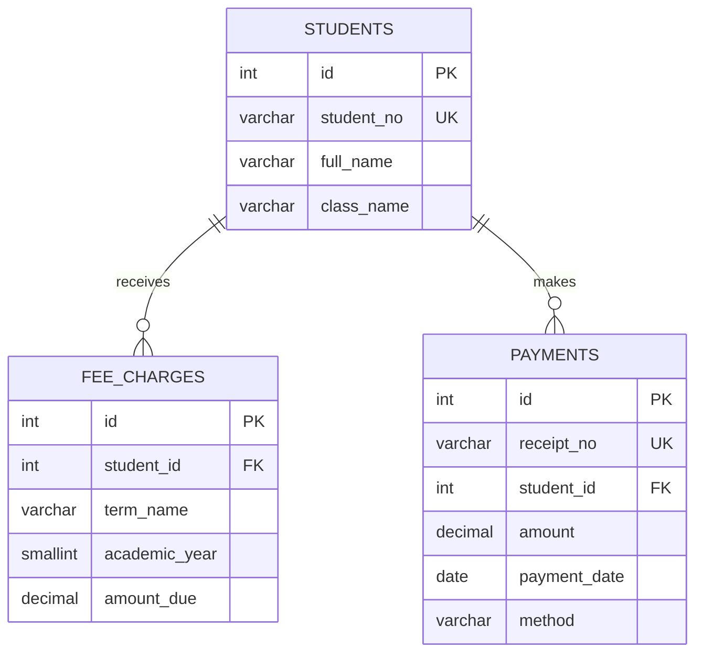

# System Architecture & Database Schema

## 1. Purpose
Prototype a small school's integrated student and fee management processes.

## 2. Modules
- Student Management: create, read, update, search and delete student records.
- Fees/Finance: add fee charges, record payments, view payment history and calculate balances.

## 3. Database entities
### students
- `id`: primary key
- `student_no`: unique business identifier
- `full_name`, `class_name`, `guardian_phone`
- `created_at`

### fee_charges
- `id`: primary key
- `student_id`: foreign key to students
- `term_name`, `academic_year`, `amount_due`
- Unique constraint on `(student_id, term_name, academic_year)` prevents duplicate term charges.

### payments
- `id`: primary key
- `receipt_no`: unique receipt identifier
- `student_id`: foreign key to students
- `amount`, `payment_date`, `method`, `note`
- Check constraint requires payment amount greater than zero.

### student_balances (SQL view)
Aggregates charges and payments for each student:
`balance = total_due - total_paid`

## 4. ER diagram

## 5. Data consistency
- Primary keys identify records.
- Unique student number and receipt number prevent duplicates.
- Foreign keys ensure financial records refer to an existing student.
- Amount validation in PHP and database constraints prevent invalid amounts.
- Prepared statements separate data from SQL instructions.
- The SQL view derives balances from source transactions rather than storing duplicate totals.

## 6. Technology choice
PHP, PDO, MySQL/MariaDB, HTML and CSS were selected because they are accessible in XAMPP and easy to demonstrate locally. A larger deployment would need authentication, role-based access control, audit trails, backups, transaction handling, monitoring, security review, and potentially a more modular API-based architecture.
